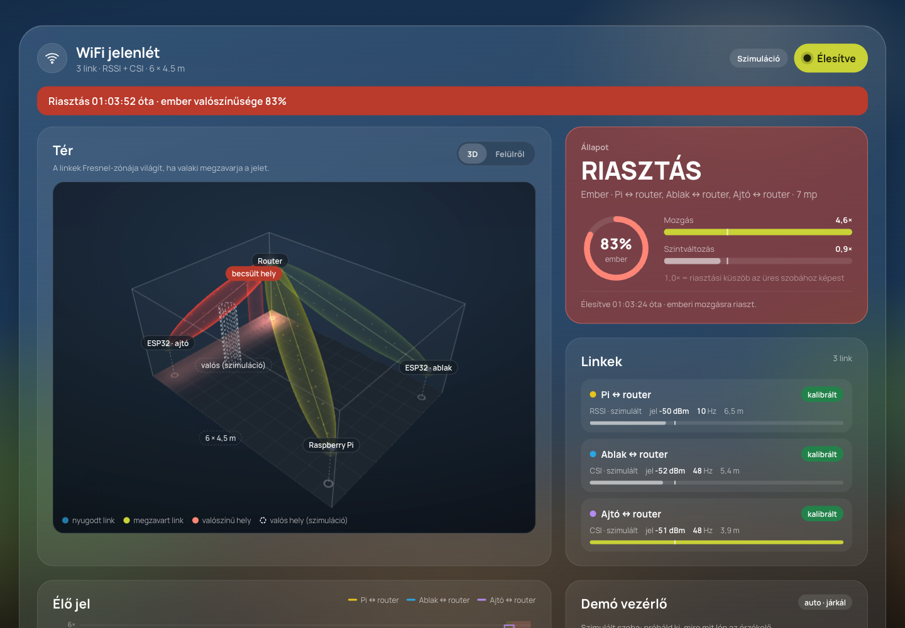

# WiFi jelenlét (wifi-sense)

Helyben futó mozgás- és jelenlétérzékelő, amely **WiFi-jelek alapján** riaszt, elsősorban
**emberi jelenlétre**. Raspberry Pi-re készült (bármilyen Linuxon fut), kamera nélkül is működik:
sötétben, takarásban és fal mögött is. A `pi_camera` (Camera Stack) projekt része lesz; ugyanazokat a
konvenciókat követi (defaults → YAML → env, ntfy, SQLite, FastAPI, magyar üveg-UI).

> *English: WiFi-based motion and human-presence alarm for the Raspberry Pi. It watches how people
> disturb WiFi links (the Pi's own RSSI, optionally ESP32 CSI), learns the empty room, and raises an
> ntfy/webhook alarm when armed. A 3D view shows the links, their Fresnel zones and the likely location.*



## Mit tud

- **Mozgásérzékelés WiFi-linkeken.** Egy link egy adó → vevő pár (például router → Pi). Ha valaki
  a kettő közötti vonal közelében mozog, a teste árnyékol és visszaver, a jel ingadozik.
- **Ember vagy nem ember.** Egy heurisztika (erősség, kitartás, gépies periodikusság) szétválasztja
  a járó embert az interferencia-tüskétől, a ventilátortól és (részben) a háziállattól.
- **Állapotok:** tanulás → üres → mozgás ⇄ jelenlét → üres. A „jelenlét” azt jelenti, hogy nemrég
  mozgás volt, vagy a link szintje tartósan elmozdult (mozdulatlan ember a linkben, főleg CSI-vel).
- **Élesítés és riasztás:** kilépési késleltetéssel; csak élesítés utáni, friss emberi mozgásra riaszt.
  Értesítés **ntfy**-on (ugyanaz a topic lehet, mint a kameráé) és/vagy JSON **webhookon**.
- **Kalibrálás:** üres szobában egy perc alatt felveszi az alapvonalat; addig automatikusan becsül
  a legcsendesebb időszakokból. Lassú sodródást (hőmérséklet, bútor) üres szobában követ.
- **3D térnézet:** szoba, router és érzékelők, a linkek első Fresnel-zónája (ott a legérzékenyebb),
  áramló jelrészecskék, és 2+ linknél a padlón a valószínű hely hőtérképe.
- **Eseménynapló** SQLite-ban (alapból 30 napig), élő grafikon, linkállapot, demó vezérlő.

## Mit nem tud (őszintén)

A WiFi nem kamera: a jel ingadozásából következtet.

| Helyzet | Pi saját RSSI | ESP32 CSI |
| --- | --- | --- |
| Járkáló ember a link közelében | jól | nagyon jól |
| Ember a szoba másik végén, messze a linktől | gyengén | közepesen |
| Mozdulatlanul ülő/fekvő ember | nem | korlátozottan (a linkben) |
| Ember vagy nagy kutya | nem különíti el | nem különíti el |
| Ventilátor, mosógép | félrevezetheti | többnyire kiszűri |
| Hely becslése | nem (egy link) | durván, 2–3 link kell |

Javaslat: több link keresztezze a szoba fő útvonalait (ajtó, folyosó). A legjobb eredmény:
WiFi-riasztás + a kamera megerősítése (lásd [Integráció](#integráció-a-camera-stackkel)).

## Hardver

1. **Csak a Raspberry Pi (alap).** A Pi a saját WiFi-kapcsolatának jelerősségét (RSSI) méri a
   routerhez, `/proc/net/wireless`-ből, root nélkül. A Pi-nek WiFi-n kell csatlakoznia (nem
   Etherneten), és a routerrel szemben, a szoba túloldalán áll a legjobban.
2. **ESP32 CSI érzékelők (ajánlott bővítés).** Egy ESP32 (pl. ESP32-S3, pár ezer forint) az
   Espressif [esp-csi](https://github.com/espressif/esp-csi) `csi_recv_router` példájával a routerre
   csatlakozik, és minden csomag csatornaállapotát (CSI, alvivőnként) kiírja USB-soros porton.
   USB-n a Pi-re dugva `serial: /dev/ttyUSB0`, vagy saját firmware-rel UDP-n (`udp_port`). Ugyanaz
   a `CSI_DATA,...,"[...]"` sorformátum. Több ESP32 = több link = hely is becsülhető.
3. *(Haladó, nincs beépítve)* A Pi 4 saját chipjéből a [nexmon_csi](https://github.com/seemoo-lab/nexmon_csi)
   is ad CSI-t, de monitor módba teszi a WiFit (a Pi-nek Ethernet kell), és kernelfüggő.

## Gyors kipróbálás (demó, bármilyen gépen)

```bash
python3 -m venv .venv && .venv/bin/pip install -r requirements.txt
.venv/bin/python -m wifisense.main --demo
```

UI: **http://127.0.0.1:8010**. A `--demo` beépített 6 × 4,5 m-es szobát használ egy RSSI- és két CSI-linkkel,
szimulált jelekkel. Kb. 30 mp után valaki belép, járkál, leül, kimegy; a **Demó vezérlő** gombjaival
magad is irányíthatod (belép, járkál, mozdulatlan, kimegy, ventilátor, macska). A 3D nézetben a
szaggatott alak a szimulált ember valós helye, a piros a becslés. A demó adatai külön kalibrációs
fájlba kerülnek, a valódi telepítést nem zavarják.

## Telepítés Raspberry Pi-re

### Docker (ajánlott, mint a kamerához)

```bash
cp .env.example .env && chmod 600 .env   # NTFY_URL, NTFY_TOPIC, ...
# config.yaml: szoba mérete, a router és a Pi helye méterben
mkdir -p data
docker compose up --build -d
docker compose logs -f wifi
```

A konténer **`network_mode: host`**-tal fut: a Pi `wlan0`-ja és az ESP32-k UDP-csomagjai csak a
host hálózatában látszanak. Ezért nincs portleképezés; a `WIFI_WEB_HOST` dönt: `127.0.0.1` csak a
Pi-ről érhető el (pl. Tailscale Serve mögé), `0.0.0.0` a LAN-ról és a tailnetről is.
Beépített hitelesítés nincs: ne tedd ki a portot az internetre. USB-s ESP32-höz a
`docker-compose.yml` `devices` és `group_add` sorait kell kikommentelni.

### Natív (systemd, Docker nélkül)

```bash
git clone … ~/wifi-sense && cd ~/wifi-sense
python3 -m venv .venv && .venv/bin/pip install -r requirements.txt pyserial
cp .env.example .env && chmod 600 .env
mkdir -p ~/.config/systemd/user && cp deploy/pi/wifisense.service ~/.config/systemd/user/
systemctl --user daemon-reload && systemctl --user enable --now wifisense
sudo loginctl enable-linger "$USER"
```

### Ajánlott Pi-beállítás

```bash
sudo iw dev wlan0 set power_save off   # különben a chip alszik a beaconok között: ritkább mérés
```

Tartóssá tehető NetworkManagerrel (`wifi.powersave = 2`) vagy egy `@reboot` crontab-sorral.
A UI figyelmeztet, ha az energiatakarékos mód be van kapcsolva.

## Használat

1. **Helyek megadása** a `config.yaml`-ban: a szoba bal hátsó sarka az origó, `x` a szélesség,
   `y` a magasság, `z` a mélység mentén. ±20 cm pontosság elég.
2. **Kalibrálás:** hagyd el a szobát, és nyomd meg a *Kalibrálás indítása* gombot (60 mp). Ha egy
   ventilátor vagy klíma általában megy, kalibrálj bekapcsolt állapotban.
3. **Élesítés:** jobb felső gomb. A kilépési késleltetés (alap 60 mp) alatt kimehetsz; utána
   az első megerősített emberi mozgás riaszt, epizódonként egyszer. Hatástalanítás: ugyanaz a gomb.
4. **Hangolás:** túl sok téves riasztás esetén emeld a `WIFI_MOTION_THRESHOLD`-ot (pl. 5–6) vagy a
   `WIFI_HUMAN_THRESHOLD`-ot; ha nem vesz észre, csökkentsd, vagy tegyél fel egy ESP32-t.

## Konfiguráció

Teljes lista: [.env.example](.env.example). Precedencia: defaults → `config.yaml` → env.
A szoba, a csomópontok (`nodes`) és a linkek (`links`) csak a YAML-ban adhatók meg.

| Beállítás | Viselkedés |
| --- | --- |
| `WIFI_SOURCE=sim` | Minden link szimulált (fejlesztés); `--demo` beépített szobával |
| `WIFI_INTERFACE` | Az RSSI-linkek WiFi-interfésze, alap `wlan0` |
| `WIFI_MOTION_THRESHOLD` | Mozgásküszöb (robusztus z-érték az üres szobához); UI-ban 1,0× |
| `WIFI_HOLD_SECONDS` | Ennyi ideig marad nyitva az epizód az utolsó mozgás után |
| `WIFI_HUMAN_THRESHOLD` | Ember-valószínűség küszöbe, `WIFI_CONFIRM_SECONDS`-ig kell tartania |
| `WIFI_ALARM_TRIGGER` | `human`: csak emberre; `any`: minden mozgásra |
| `WIFI_ARM_DELAY_SECONDS` | Kilépési késleltetés élesítés után |
| `NTFY_URL` + `NTFY_TOPIC` | Mindkettő kell; ugyanazok a változók, mint a kameránál |
| `WIFI_WEBHOOK_URL` | JSON POST minden riasztáskor |
| `WIFI_WEB_HOST`, `WIFI_WEB_PORT` | UI címe, alap port **8010** (a kamera a 8000-en fut) |

Az adatok a `data/` alatt: `wifi-calibration.json`, `wifi-settings.json` (élesítés),
`wifi-events.sqlite3`, `logs/wifisense.log`.

## Hogyan működik

```text
forrás (link-szál)      ablak (3 mp, 2×/s)          alapvonal            döntés
/proc/net/wireless ─┐   RSSI szórás, szint      ┌─ kalibrált vagy ─┐   z-érték / küszöb
ESP32 CSI_DATA ─────┼─► CSI szórás, profil  ───►│  automatikus     ├─► ember-valószínűség
szimulátor ─────────┘   gépies periodikusság    └─ sodródáskövetés ┘   állapotgép → esemény → riasztás
```

- **Mozgás:** az ablakon belüli szórás (RSSI-dBm, ill. a gain-normalizált CSI-amplitúdók) robusztus
  z-értéke az üres szoba eloszlásához képest. A küszöb fölött `WIFI_TRIGGER_SECONDS`-ig → epizód.
- **Jelenlét:** a szint (RSSI-átlag, CSI-profil korrelációja) tartós eltérése. Mozgás nélkül legfeljebb
  `WIFI_STATIC_MAX_SECONDS`-ig tartja nyitva az epizódot, utána ez lesz az új üres szoba.
- **Ember-valószínűség** = erősség (medián, nem csúcs) + kitartás (az utolsó 4 mp aránya) − gépies
  periodikusság (egyetlen éles spektrumvonal 1,5 Hz fölött, mint egy ventilátorlapáté).
- **Hely:** a padlót 25 cm-es cellákra osztja; egy cella annál valószínűbb, minél jobban egyezik,
  hogy mely linkek Fresnel-zónájába esik a megzavart és a nyugodt linkekkel. Egy linknél ez csak sáv.

## API

| Végpont | Leírás |
| --- | --- |
| `GET /health` | `ok` / `error` (egyik link sem mér) |
| `GET /api/status` | elrendezés, küszöbök, értesítések, legutóbbi állapot |
| `GET /api/stream` | Server-Sent Events, 2×/s: állapot, linkek, hőtérkép, élesítés |
| `GET /api/live?seconds=120` | grafikonpontok |
| `GET /api/events?limit=20` | epizódok (legújabb elöl) |
| `POST /api/arm` `{"armed": true}` | élesítés / hatástalanítás |
| `POST /api/calibrate` `{"seconds": 60}` / `{"cancel": true}` | kalibrálás |
| `POST /api/notify-test` | teszt értesítés |
| `POST /api/sim` `{"action": "enter"}` | csak szimulált módban |

Az írások JSON-törzset várnak: a CORS-preflight miatt más weboldal nem élesítheti a rendszert.

## Integráció a Camera Stackkel

Tervezett lépések a `pi_camera` projektbe olvasztáshoz:

1. **Közös Compose-projekt:** külön `wifi` szolgáltatásként ugyanabból a repóból
   (`network_mode: host`), közös `.env` (`NTFY_*`, `TZ`, `LOG_LEVEL`), közös `data/` (a fájlnevek
   `wifi-` előtagúak, nem ütköznek).
2. **Kölcsönös megerősítés:** a WiFi-riasztás webhookja (`WIFI_WEBHOOK_URL`) nyitja a kamera
   AI-kapuját, illetve a kamera person-eseménye megerősíti a WiFi-epizódot; két független érzékelő
   egyezése sokkal kevesebb téves riasztást ad.
3. **UI:** a dashboard a kamera üveg-dizájnját használja; a kamera dockjába egy „WiFi” lap kerül.

## Fejlesztés és tesztek

```bash
.venv/bin/pip install -r requirements.txt pytest httpx ruff
.venv/bin/python -m pytest -q      # hardver nélkül: virtuális idős szimulátor
.venv/bin/ruff check .
docker build --target test -t wifi-sense:test . && docker run --rm wifi-sense:test
```

A tesztek a teljes láncot virtuális időben futtatják (szimulált szoba → jellemzők → alapvonal →
állapotgép → riasztás → SQLite), plusz parsereket (`/proc/net/wireless`, `iw`, ESP32 CSI), a
konfigurációt és az API-t.

```text
wifisense/
├── main.py         # belépési pont: python -m wifisense.main [--demo]
├── config.py       # defaults → YAML → env, demó elrendezés
├── sources/        # rssi.py (Linux), esp32.py (CSI), sim.py (szimulált szoba)
├── buffer.py       # szálbiztos mintapuffer linkenként
├── features.py     # ablakjellemzők, gépies periodikusság
├── detector.py     # alapvonal, linkpontszám, ember-valószínűség, állapotgép
├── localize.py     # Fresnel-zónás hőtérkép és helybecslés
├── runtime.py      # tick-szál, kalibrálás, epizódok, riasztás
├── events.py       # SQLite epizódnapló
├── notifier.py     # ntfy + webhook
├── settings.py     # élesítés, tartósan
├── web.py          # FastAPI + SSE
└── static/         # UI, 3D nézet (three.js, helyben), Manrope betűtípus (OFL)
```
